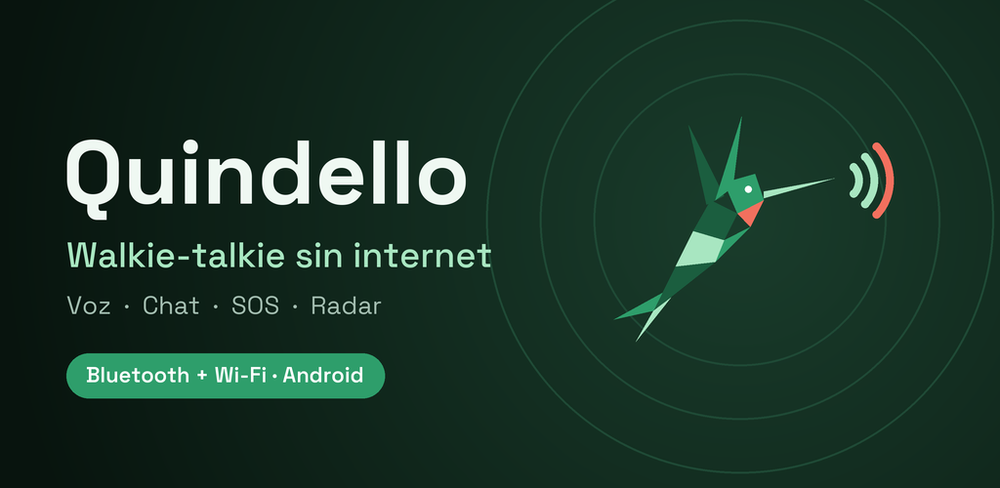

# Quindello 📡 · Walkie talkie sin internet para Android



> **Habla con tu grupo aunque no haya señal.**
> App de walkie talkie offline por **Bluetooth** con **red mesh**, chat, **SOS** y **radar** para encontrar a tu grupo.
> Para la **montaña**, **conciertos**, **zonas rurales** y **emergencias**.

[](https://github.com/RiccijandroUpec/Quindello/releases/latest)
[](https://github.com/RiccijandroUpec/Quindello/releases)


[](https://riccijandroupec.github.io/Quindello/)

🌐 **Sitio web:** [riccijandroupec.github.io/Quindello](https://riccijandroupec.github.io/Quindello/) · [Política de privacidad](https://riccijandroupec.github.io/Quindello/privacidad.html)

Quindello convierte tu celular Android en un **radio walkie talkie que funciona sin internet, sin datos móviles y sin señal de celular**. Los teléfonos se conectan **directamente entre ellos** por Bluetooth y forman una **red mesh**: cada teléfono retransmite los mensajes de los demás para llegar más lejos.

**Sin cuentas · sin servidores · sin internet · gratis.**

*Quinde* es el nombre del colibrí en Ecuador: pequeño, rápido y siempre conectado con los suyos.

---

## ⬇️ Descargar

**[👉 Descargar la última versión (APK)](https://github.com/RiccijandroUpec/Quindello/releases/latest)**

1. **Si tienes la v0.4.x o anterior, desinstálala antes de instalar la v0.5.0** (solo esta vez): la app ahora va firmada con su llave definitiva y Android no deja instalarla encima. Se pierden tu nombre, tus grupos y el historial; para volver a una frecuencia privada pide que te inviten de nuevo. Desde la v0.5.0, las nuevas versiones se instalan encima sin perder nada. La v0.5 se ve con la v0.4.x (mismo protocolo), pero no con la v0.3.x ni anteriores.
2. Abre el APK en el teléfono y permite **instalar apps de origen desconocido**.
3. Requiere **Android 8.0+** y Google Play Services. Para probarla necesitas **al menos dos teléfonos reales**: los emuladores no tienen Bluetooth real.

---

## 🏔️ ¿Para quién es?

| Situación | Cómo ayuda Quindello |
|---|---|
| 🥾 **Montañismo, trekking y camping** | Volcanes, páramos y senderos sin cobertura: el grupo sigue comunicado y nadie se pierde. |
| 🎪 **Conciertos, festivales y estadios** | Cuando la red se satura, tu grupo de amigos sigue hablando. |
| 🆘 **Emergencias y desastres** | Sismos, apagones o caída de la red celular: SOS con ubicación GPS y pase de lista. |
| 🌾 **Zonas rurales** | Comunicación en fincas, comunidades y lugares con poca señal. |
| 👨‍👩‍👧 **Familias y viajes** | Parques, ferias o cruceros sin roaming: encuentra a los tuyos con la flecha. |
| 🧑‍🚒 **Rescate, scouts y equipos de trabajo** | Frecuencias privadas cifradas con roles: admin, moderador, miembro y solo escucha. |

### ¿Por qué Quindello?
- 🎙️ **Voz de verdad (PTT):** no es solo un chat; presionas y hablas como en un walkie talkie.
- 👥 **Pensado para grupos:** frecuencias, roles y admin.
- 🆘 **Emergencias integradas:** SOS, estados rápidos, radar y "Buscar a alguien".
- 🔁 **Red mesh:** más alcance mientras más personas la usan.
- 🔐 **Privado:** cifrado AES-256, mensajes firmados, llaves guardadas en el Keystore del teléfono, sin cuentas y sin servidores.
- 🔋 **Modos de energía:** el Wi-Fi solo se enciende en modo Rendimiento.

---

## ✨ Funciones (v0.5.0)

### 📻 Radio
- **PTT**: mantén presionado para hablar, también con el botón **Volumen −**.
- **Frecuencias 01–99**, con un solo emisor a la vez, como un walkie real.
- **Voz comprimida con Opus**: ~20 veces menos datos que el audio sin comprimir.
- **Beep Quindello** al terminar cada transmisión.
- **Sigue encendido al salir de la app**, con una notificación fija y un botón Apagar.

### 🔔 Notificaciones (con la app en segundo plano)
- **SOS y estados urgentes**: aviso con vibración fuerte, distancia y botón **Buscar**. La sirena suena por el **volumen de alarma**, aunque tengas la música en cero.
- **Mensajes de texto**: aviso con los últimos mensajes y botón **Responder** sin abrir la app.
- En la **pantalla bloqueada** solo se ve "Nuevo mensaje" o "SOS en tu frecuencia".
- Cada aviso (SOS y alertas, Mensajes, Radio encendido) se puede apagar por separado en los ajustes de Android.

### 💬 Chat
- Mensajes de texto por la misma frecuencia, sin internet.
- Registro de transmisiones de voz, de quién entra y de quién sale.
- **Historial guardado por canal**: no se pierde al cerrar la app.
- PTT dentro del chat.

### 🔐 Frecuencias privadas
- **Cifradas con AES-256-GCM**: quien no tiene la llave solo recibe ruido.
- Quien crea la frecuencia es el **admin**.
- **Entrar por QR** (en persona) o **pidiendo entrar**: el admin acepta y ambos confirman un **código de 4 dígitos**.
- **Roles**: Admin, Moderador (puede aceptar gente), Miembro y Solo escucha.
- **Expulsar**: se crea una llave nueva y se entrega cifrada a cada miembro, menos al expulsado.
- Las órdenes del admin van **firmadas** (ECDSA): nadie puede hacerse pasar por él.

### 🆘 Emergencias
- **SOS**: se activa manteniendo presionado 2 s. Envía tu ubicación GPS, suena una sirena en los demás teléfonos y se repite cada minuto.
- **Estados rápidos**: Estoy bien, Necesito ayuda, Me perdí, Estoy herido, Espérenme.
- **Pase de lista**: pregunta a todos si están bien.

### 🧭 Radar
- Brújula con la **dirección y distancia** de cada persona del grupo, con GPS sin internet.
- **Batería** y **estado** de cada uno.
- Toca a alguien para abrir su posición en tu app de mapas.

### 🧭 Buscar a alguien
- Toca a una persona en el Radar (o **Buscar** en una alerta SOS): una **flecha grande** apunta hacia ella mientras giras el teléfono.
- **Distancia en vivo** e indicaciones: "Gira a la derecha", "Vas bien", "¡Está muy cerca!".
- **Vibra** cuando apuntas bien (doble vibración a menos de 15 m): puedes caminar sin mirar.
- Su teléfono envía la ubicación **cada 5 s** mientras la buscas (solo si comparte ubicación o envió SOS).
- Avisa si la **brújula necesita calibrarse** o si el GPS es impreciso.

### 📡 Escáner
- Frecuencias **en uso cerca de ti**, con cuántas personas hay en cada una.
- Frecuencias privadas 🔒 con botón **Pedir entrar**.

### 🔁 Red mesh
- Cada teléfono **retransmite** lo que recibe: A puede hablar con C a través de B.
- Saltos máximos: voz 2, texto 4, SOS 6.
- Muestra quién está **directo** y quién **vía mesh**.

### 🔋 Modos de energía
| Modo | Conexión | Voz | GPS | Búsqueda | Para qué |
|---|---|---|---|---|---|
| ⚡ **Rendimiento** | Bluetooth + Wi-Fi | Opus 24 kbps | Siempre (radar en vivo) | Continua | Mejor voz y alcance |
| 🔋 **Ahorro** (por defecto) | Solo Bluetooth, **nunca enciende el Wi-Fi** | Opus 12 kbps | Solo al abrir el radar, al buscar o ser buscado y con SOS | Continua hasta encontrar a alguien; luego 20 s cada 90 s | Todo el día |
| 🆘 **Supervivencia** | Bluetooth de bajo consumo, sin Wi-Fi | Solo texto, estados y SOS | Solo con SOS o si te buscan | Continua hasta encontrar a alguien; luego 15 s cada 3 min | Aguantar días |

En Ahorro, al abrir el **Radar** se pide a los demás que envíen su ubicación durante 40 s. Al cambiar de modo, las conexiones se rehacen con las reglas del modo nuevo.

> ℹ️ En Android 11 o anterior (y en algunos modelos más nuevos), Android exige tener activado el ajuste de **Ubicación** para buscar por Bluetooth. Eso no enciende el GPS: el GPS solo se usa en los casos de la tabla.

Con **Ahorro automático** activado, la app pasa a Ahorro cuando la batería baja del 20 %.

---

## 🧪 Cómo probar

1. Instala la app en **2 o 3 teléfonos**.
2. Completa la bienvenida (nombre y permisos).
3. **Pública:** pon la misma frecuencia en todos, toca **Encender radio** y habla con **PTT**.
4. **Privada:** en uno, toca la tarjeta de frecuencia → **Crear privada** → **Invitar** (QR). En otro, **Escanear QR**.
5. **Pedir entrar:** en otro teléfono, abre **Escáner** → frecuencia 🔒 → **Pedir entrar**. El admin verá el código y podrá aceptar.
6. **Mesh:** pon el teléfono A y el C lejos uno del otro, con B en medio.
7. **SOS:** toca **SOS** → mantén presionado 2 s.

### Alcance aproximado
| Entorno | Directo | Con mesh |
|---|---|---|
| Al aire libre | ~100 m | +100 m por cada teléfono intermedio |
| Edificios / bosque | 10 – 50 m | Igual, multiplicado por cada salto |

---

## ❓ Preguntas frecuentes

**¿Funciona sin internet ni señal?**
Sí. No usa datos móviles, Wi-Fi de internet ni servidores. Los teléfonos se conectan directamente por Bluetooth (y por Wi-Fi directo en modo Rendimiento).

**¿Qué alcance tiene?**
Unos 100 m al aire libre entre dos teléfonos, y de 10 a 50 m entre paredes o en el bosque. Con la red mesh, cada teléfono intermedio suma más alcance.

**¿Qué es la red mesh?**
Cada teléfono funciona como repetidor. Si Ana está lejos de Pedro pero Luis está en medio, el mensaje pasa por el teléfono de Luis automáticamente:
```
📱 Ana  ——→  📱 Luis  ——→  📱 Pedro
```
En frecuencias privadas, quien está en medio reenvía el mensaje cifrado **sin poder leerlo**.

**¿Es gratis? ¿Necesito crear una cuenta?**
Es gratis y no necesita cuenta, número de teléfono ni correo.

**¿Alguien puede escuchar mis conversaciones?**
En las frecuencias públicas, sí: como en un walkie talkie real, cualquiera en esa frecuencia te escucha. Para conversaciones privadas, crea una **frecuencia privada**: va cifrada con AES-256-GCM y solo entra quien el admin acepta.

**¿Gasta mucha batería?**
En modo **Ahorro** (por defecto) usa solo Bluetooth, y el GPS se enciende solo cuando hace falta. El modo **Supervivencia** está pensado para aguantar días.

**¿Funciona en iPhone?**
Por ahora solo en Android 8.0 o superior.

**¿En qué se diferencia de otras apps offline?**
Quindello está pensada como **radio de voz para grupos**: walkie talkie con PTT, frecuencias con admin, SOS con sirena, radar y una flecha con brújula para encontrar a alguien.

---

## 🌎 In English

**Quindello is an offline walkie talkie app for Android.** It works **without internet, mobile data or cell signal**. Phones connect directly over Bluetooth and form a **mesh network**: each phone relays messages to reach further.

- 🎙️ **Push-to-talk voice** (Opus codec) on 99 channels, plus text chat with history.
- 🔐 **Private encrypted channels** (AES-256-GCM) with admin, roles and QR invites.
- 🆘 **SOS with GPS location** and siren, quick statuses and roll call.
- 🧭 **Radar and "Find someone"**: a compass arrow points to a group member, with live distance and haptic feedback.
- 🔁 **Mesh relay**: voice 2 hops, text 4 hops, SOS 6 hops.
- 🔋 **Power modes**: Performance, Saver (Bluetooth only, never turns on Wi-Fi) and Survival.
- **No accounts, no servers, no internet.**

Useful for **hiking, mountaineering, camping, festivals, concerts, rural areas, disaster response and emergencies**.

**[Download the latest APK](https://github.com/RiccijandroUpec/Quindello/releases/latest)** · Android 8.0+

---

## 🔐 Seguridad y privacidad
- **Sin datos personales:** no hay cuentas, ni servidores, ni analíticas. Nada sale de tu teléfono hacia internet.
- **Identidad:** cada teléfono crea un par de llaves EC P-256. La huella se ve en Ajustes. Nadie puede hacerse pasar por otro teléfono.
- **Mensajes firmados:** texto, SOS, estados y ubicación van firmados por quien los escribió.
- **Grupo:** llave AES-256 compartida. Para unir un enlace, el otro debe demostrar que tiene la llave con un saludo firmado y cifrado; si no, se corta.
- **Entregar la llave:** por QR (en persona, siempre como miembro) o cifrada solo para quien pidió entrar.
- **Admin:** firma sus órdenes; una orden vieja no se puede repetir y una expulsión cambia la llave del grupo.
- **En el teléfono:** la llave privada, las llaves de los grupos y el historial del chat se guardan cifrados con el Keystore de Android.
- **Ubicación:** en frecuencias públicas tu posición solo se envía con un SOS. En tu grupo, solo si activas "Compartir mi ubicación".
- ⚠️ **Limitaciones conocidas:** si se expulsa a alguien, quien no esté en rango en ese momento debe volver a entrar con el QR.


---


## 🩺 Solución de problemas

| Problema | Solución |
|---|---|
| No aparece nadie | Misma **versión** de la app en todos, misma frecuencia (o mismo grupo), con Bluetooth y Ubicación activados. Espera de 10 a 30 s hasta ver "X entró en rango" en el chat. |
| Error 8034 / permisos | En el aviso toca **Permisos** y activa Ubicación, Dispositivos cercanos y Micrófono. |
| No puedo hablar | Mira el texto bajo el botón: otra persona está hablando, tu rol es Solo escucha o estás en modo Supervivencia. |
| El radar no me ubica | Sal al aire libre y activa la ubicación. El GPS funciona sin internet, pero tarda en encontrar la posición. |
| La app se cierra | Desinstala la versión anterior e instala de nuevo. Si continúa, [repórtalo](https://github.com/RiccijandroUpec/Quindello/issues/new) con el modelo del teléfono. |

---

## 🗺️ Hoja de ruta

- [x] **v0.1:** frecuencias, PTT, botón de volumen.
- [x] **v0.2:** diseño Quinde, chat con historial, escáner, segundo plano, Opus, modos de energía, frecuencias privadas cifradas con admin, SOS, radar, red mesh, bienvenida, pruebas automáticas.
- [x] **v0.3:** Buscar a alguien (flecha con brújula, distancia en vivo y vibración).
- [x] **v0.3.1:** conexión más fiable entre teléfonos (sin choques al conectar, reintentos siempre, búsqueda continua mientras estás solo).
- [x] **v0.3.2:** Wi-Fi solo en Rendimiento; en Ahorro y Supervivencia el GPS solo se usa cuando hace falta.
- [x] **v0.4:** más seguridad (mensajes firmados, llaves en el Keystore de Android), ícono nuevo, fuente de marca y modo de alto contraste para usar al sol.
- [x] **v0.4.1:** sección "Acerca de" (novedades, privacidad, permisos, autor, licencias y botón para compartir la app).
- [x] **v0.5:** notificaciones de SOS y mensajes (con Responder), sirena por volumen de alarma y firma de release definitiva.
- [ ] **v0.5.x:** audífonos Bluetooth, widget PTT.
- [ ] **v0.6:** notas de voz guardadas y reenviadas (para quien estaba fuera de rango), mapas offline.
- [ ] **v1.0:** versión release firmada, política de privacidad, idiomas (español, inglés, kichwa), Play Store.
- [ ] **Futuro:** accesorio con radio LoRa para alcance de kilómetros.

---

**Quindello — Habla aunque no haya señal.** 🎙️📡

## 🐞 Reportar un problema o sugerir una idea

Abre un **[Issue](https://github.com/RiccijandroUpec/Quindello/issues/new)** e indica el modelo de tu teléfono, la versión de Android y la versión de Quindello (en Ajustes).

---

## 📄 Licencia

© 2026 Riccijandro (Ecuador). **Todos los derechos reservados.**
Quindello es **gratis para usar**. El código fuente es privado: no está permitido copiar, modificar, redistribuir ni vender la app ni partes de ella sin permiso del autor.

Quindello usa componentes de terceros con sus propias licencias: [Concentus](https://github.com/lostromb/concentus) (BSD 3-Clause), [ZXing](https://github.com/zxing/zxing) y [ZXing Android Embedded](https://github.com/journeyapps/zxing-android-embedded) (Apache 2.0), AndroidX y Jetpack Compose (Apache 2.0), Google Play Services Nearby (términos de Google APIs) y la fuente [Space Grotesk](https://github.com/floriankarsten/space-grotesk) (SIL Open Font License 1.1).

---

¿Te sirvió? Dale una ⭐ al repositorio y compártelo con tu grupo: **mientras más personas tienen Quindello, más lejos llega la red.**

<sub>Palabras clave: walkie talkie sin internet, walkie talkie offline, app sin señal, comunicación sin internet, chat sin internet, Bluetooth mesh, red mesh Android, push to talk, PTT, radio offline, app de emergencia, SOS offline, montañismo, trekking, Ecuador · offline walkie talkie, no internet messenger, off-grid communication, mesh network app, Bluetooth walkie talkie, emergency app Android.</sub>
